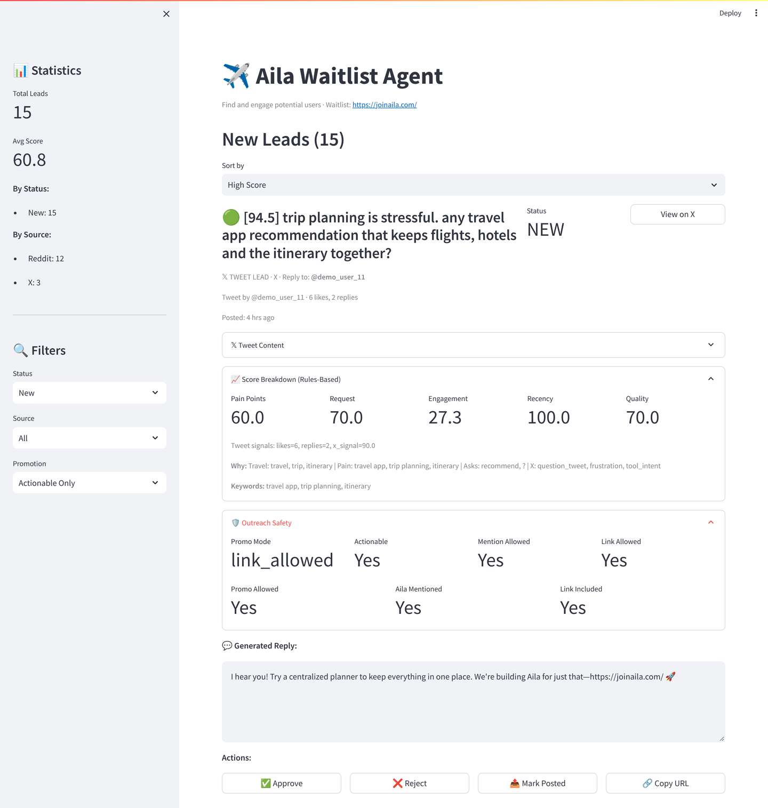

# Aila Waitlist Agent

[](https://github.com/Unmesh30/aila-waitlist-growth-agent/actions/workflows/ci.yml)

**Finds people asking for help with trip planning on Reddit and X, scores each post 0–100, and drafts a reply that a person approves before anything is posted.**

I built this during my internship at Lunar Guide (Feb–Jun 2026) to grow the waitlist for Aila, its AI travel planner. – Unmesh Achar

**Interactive demo:** https://unmesh30.github.io/aila-waitlist-growth-agent/ shows the agent's real code run on made-up sample posts: ranked leads, score breakdowns, what it turned down and why, and the drafted replies with approve and reject buttons.



## In one minute

- **The goal:** find Aila's first users among people already posting about stressful trip planning, and answer them in a way that helps first and respects each community's rules.
- **What it does:** collects recent posts and comments, scores each one 0–100 with a weighted rule (pain points 30%, requests 25%, engagement 20%, recency 15%, quality 10%), keeps the best, and drafts one reply per lead with a local LLM through Ollama.
- **Guardrails:**
  - Each community's rules decide what a reply may contain: a link, a mention of Aila without a link, or no promotion at all. Leads from communities that don't allow promotion never reach the queue.
  - After the model writes, a sanitizer enforces those rules again, removing any link or promotional sentence the community doesn't allow.
  - Facts in replies, such as visa or airline rules, come only from an allowlist of official domains.
- **A person approves everything:** nothing is posted automatically. Drafts wait in a Streamlit review dashboard, which the team used daily, where each one is approved or rejected and marked as posted once someone has posted it by hand.

## Try it in about two minutes (no API keys, no Ollama)

```bash
git clone https://github.com/Unmesh30/aila-waitlist-growth-agent.git
cd aila-waitlist-growth-agent
python3 -m venv venv && source venv/bin/activate   # Python 3.11 or 3.12
pip install -r requirements.txt
python3 run_pipeline.py --demo       # runs the pipeline offline on bundled sample posts
python3 launch_dashboard.py --demo   # opens the review dashboard at http://localhost:8501
```

Demo mode swaps only the network calls (Reddit, X, web search) and the model for bundled, made-up sample posts in `demo/fixtures/` and a stand-in model. The stand-in replays replies recorded from the real local model (`python3 run_pipeline.py --demo --record-replies`, which needs Ollama), or gives a labelled placeholder where none are recorded. Scoring, comment extraction, the promotion rules, the source allowlist, the sanitizer, the database and the dashboard are the same code that runs live. Demo data goes to `data/demo/demo_leads.db`, separate from real leads, and `data/demo/run_report.json` lists every candidate and what happened to it.

## Tests

```bash
pip install -r requirements-dev.txt
pytest
```

22 tests cover the scoring weights and ranking, de-duplication, the reply sanitizer, the source allowlist (including look-alike domains), the community promotion rules, parsing of X posts, the whole demo pipeline end to end, recording and replaying model replies, the dashboard (it renders the demo leads and records an approval) and the demo page. GitHub Actions runs them on Python 3.11 and 3.12 on every push.

## Changes since the internship (November 2026)

The original code from the internship is commit [`ba1ea27`](https://github.com/Unmesh30/aila-waitlist-growth-agent/tree/ba1ea27de94bd06b0d33bc0bf237ba2d7210b104). Since then I have added:

- An offline demo mode (`--demo`) on made-up sample posts, which can replay replies recorded once from the real local model (`--record-replies`).
- 22 automated tests and a CI workflow.
- An interactive demo page (`python3 -m demo.export_site --out site`), built from a demo run and published on GitHub Pages.
- **Fix:** the source allowlist matched domains by suffix, so a look-alike such as `visa-help-gov.uk` passed as `gov.uk`. It now accepts only the exact domain or a real subdomain.
- **Fix:** where a community allows a mention but not a link, removing the link left a sentence hanging on "for exactly this:". The sentence now ends cleanly.
- **Fix:** a fresh install could not start the dashboard, because newer pyarrow releases need NumPy 2, which Streamlit 1.31 doesn't support. pyarrow is now pinned.
- **Fix:** the reply style picked for each post was meant to stay the same, but Python's `hash()` of a string changes on every run, so it didn't. It now uses a stable checksum.
- The dashboard now shows X handles as @name instead of u/name.

## 🎯 What It Does

1. **Discovers** recent travel discussions on Reddit from people experiencing pain points Aila solves
2. **Scores** each post/comment by likelihood of being a good waitlist lead
3. **Generates** one final reply for top leads using local Ollama
4. **Saves** everything to a local SQLite database
5. **Provides** a Streamlit dashboard for manual review and approval

**Important:** This system is for manual review only. It does NOT auto-post. You review, approve, and manually post replies.

## 🏗️ Architecture

Built with **local-first** principles:
- ✅ **No paid APIs required** for core workflow
- ✅ Uses Reddit's free public JSON API (no API key needed)
- ✅ Uses local Ollama for reply generation (no paid cloud API)
- ✅ The model runs on your own computer; only collecting posts needs the internet
- ✅ SQLite database for persistence

**Discovery Engine:** Adapted from [last30days-skill](https://github.com/mvanhorn/last30days-skill) Reddit collection logic.

## 📋 Requirements

- **Python 3.11 or 3.12** (both tested in CI)
- **Ollama** with a local model (the setup below uses llama3; not needed for the demo)
- Internet connection (for Reddit discovery only)

## 🚀 Setup

### 1. Install Ollama

```bash
# macOS
brew install ollama

# Linux
curl -fsSL https://ollama.com/install.sh | sh

# Start Ollama
ollama serve

# Pull llama3 model
ollama pull llama3
```

### 2. Install Python Dependencies

```bash
cd aila_waitlist_agent

# Create virtual environment (recommended)
python3 -m venv venv
source venv/bin/activate  # On Windows: venv\Scripts\activate

# Install dependencies
pip install -r requirements.txt
```

### 3. Configure Environment

```bash
# Copy example env file
cp .env.example .env

# Edit .env if needed (defaults should work)
# Default: Ollama at localhost:11434, llama3 model
```

## 🎮 Usage

### Run the Discovery Pipeline

```bash
python3 run_pipeline.py
```

This will:
1. Search Reddit (and X, when `X_BEARER_TOKEN` is set in `.env`) for recent travel-planning discussions
2. Extract top comments from promising posts
3. Score each post as a potential lead (0-100)
4. Generate one final reply for top leads using Ollama
5. Save everything to `data/waitlist_leads.db`

**Options:**
```bash
# Skip comment extraction (faster but less context)
python3 run_pipeline.py --skip-comments

# Skip reply generation (discovery only)
python3 run_pipeline.py --skip-drafting

# Generate replies for top 10 leads only
python3 run_pipeline.py --max-drafts 10

# Customize comment enrichment
python3 run_pipeline.py --max-comments 20
```

### Launch the Review Dashboard

```bash
python3 launch_dashboard.py
```

Opens at `http://localhost:8501`

Dashboard features:
- **View all leads** sorted by score
- **Filter** by status (new, approved, rejected, posted)
- **Review** the final generated reply
- **Approve/Reject** leads
- **Mark as posted** after you manually post
- **Statistics** sidebar

### Workflow

1. **Run pipeline** nightly or weekly: `python3 run_pipeline.py`
2. **Review leads** in dashboard: `python3 launch_dashboard.py`
3. **Approve** high-quality leads with good replies
4. **Manually copy** approved replies to Reddit
5. **Mark as posted** in dashboard to track

## 📂 Project Structure

```
aila_waitlist_agent/
├── README.md                   # This file
├── requirements.txt            # Python dependencies
├── requirements-dev.txt        # Test and lint tools
├── .github/workflows/ci.yml    # Runs lint and tests on every push
├── .env.example               # Environment template
├── run_pipeline.py            # Main pipeline runner
├── launch_dashboard.py        # Dashboard launcher
│
├── config/                    # Configuration
│   ├── settings.py           # Global settings
│   ├── sources.py            # Reddit sources/queries
│   └── scoring.py            # Scoring weights/keywords
│
├── src/                       # Source code
│   ├── collectors/           # Reddit and X discovery
│   │   ├── discovery_adapter.py      # Reddit API wrapper
│   │   ├── reddit_recent_collector.py # Main collector
│   │   ├── x_collector.py            # X (Twitter) recent search
│   │   └── comment_extractor.py      # Comment fetcher
│   │
│   ├── scoring/              # Lead scoring
│   │   ├── lead_scorer.py    # Score calculation
│   │   └── ranker.py         # Ranking & filtering
│   │
│   ├── llm/                  # Reply generation
│   │   ├── ollama_client.py  # Ollama interface
│   │   ├── reply_generator.py # Final reply generation and sanitizer
│   │   ├── source_grounder.py # Official-source allowlist for facts
│   │   └── prompts.py        # Prompt templates
│   │
│   ├── storage/              # Database
│   │   ├── database.py       # SQLite operations
│   │   ├── repository.py     # High-level API
│   │   └── models.py         # Data models
│   │
│   ├── pipeline/             # Orchestration
│   │   ├── discovery_pipeline.py  # Discovery flow
│   │   ├── drafting_pipeline.py   # Reply generation flow
│   │   └── deduper.py            # Deduplication
│   │
│   └── utils/                # Utilities
│       ├── logger.py         # Logging config
│       ├── date_utils.py     # Date helpers
│       └── text_utils.py     # Text processing
│
├── app/                      # Dashboard
│   └── streamlit_app.py     # Streamlit UI
│
├── data/                     # Data storage
│   ├── waitlist_leads.db    # SQLite database (auto-created)
│   ├── raw/                 # Raw data cache
│   ├── processed/           # Processed data
│   └── exports/             # Export files
│
├── logs/                     # Log files
│   └── pipeline.log         # Pipeline logs
│
├── demo/                     # Offline demo mode (--demo)
│   ├── export_site.py       # Builds the live-demo page from a demo run
│   └── fixtures/            # Made-up sample posts, comments, tweets, search results
│
├── docs/
│   └── dashboard_demo.png   # Dashboard screenshot (demo data)
│
└── tests/                    # pytest suite (run: pytest)
    └── sample_inputs.json   # Sample posts/comments
```

## 🎯 Scoring Logic

Leads are scored 0-100 based on:

| Component | Weight | What It Measures |
|-----------|--------|------------------|
| **Pain Points** | 30% | Mentions of travel app frustrations, planning stress, organization problems |
| **Request** | 25% | Explicit asks for help, recommendations, advice |
| **Engagement** | 20% | Reddit upvotes and comments (community validation) |
| **Recency** | 15% | How recent the post is (fresher = better) |
| **Quality** | 10% | Post length, detail, specificity |

**Matched Keywords:**
- High intent: "too many apps", "overwhelmed", "frustrated", "struggle"
- Planning: "itinerary", "organize", "planning stress"
- Seeking help: "recommend", "looking for", "need help"

## 💬 Final Reply Style

For each selected lead, Ollama generates one final reply. Replies are designed to:
- Sound human and natural
- Be short (2-4 sentences)
- Provide genuine value first
- Position Aila as something being built, not already launched
- Make sense to other people reading the thread later
- Naturally invite relevant people to the waitlist
- Avoid spam/marketing tone

## 🧪 Testing Locally

### Run the Test Suite

```bash
pip install -r requirements-dev.txt
pytest
```

### Test Ollama Connection

```bash
python3 -c "from src.llm.ollama_client import test_ollama_connection; test_ollama_connection()"
```

### Test Reply Generation

```bash
python3 -c "from src.llm.reply_generator import test_reply_generation; test_reply_generation()"
```

### Test Discovery

```bash
# Discovery only (no drafting)
python3 run_pipeline.py --skip-drafting --max-comments 5
```

### Check Database

```bash
sqlite3 data/waitlist_leads.db

# View all leads
SELECT post_id, title, lead_score, status FROM leads ORDER BY lead_score DESC LIMIT 10;

# Count by status
SELECT status, COUNT(*) FROM leads GROUP BY status;
```

## 📅 Scheduling Nightly Runs

### Option 1: Cron (Linux/macOS)

```bash
# Edit crontab
crontab -e

# Add nightly run at 2 AM
0 2 * * * cd /path/to/aila_waitlist_agent && /path/to/venv/bin/python3 run_pipeline.py >> logs/cron.log 2>&1
```

### Option 2: launchd (macOS)

Create `~/Library/LaunchAgents/com.aila.waitlist.plist`:

```xml
<?xml version="1.0" encoding="UTF-8"?>
<!DOCTYPE plist PUBLIC "-//Apple//DTD PLIST 1.0//EN" "http://www.apple.com/DTDs/PropertyList-1.0.dtd">
<plist version="1.0">
<dict>
    <key>Label</key>
    <string>com.aila.waitlist</string>
    <key>ProgramArguments</key>
    <array>
        <string>/path/to/venv/bin/python3</string>
        <string>/path/to/aila_waitlist_agent/run_pipeline.py</string>
    </array>
    <key>StartCalendarInterval</key>
    <dict>
        <key>Hour</key>
        <integer>2</integer>
        <key>Minute</key>
        <integer>0</integer>
    </dict>
    <key>WorkingDirectory</key>
    <string>/path/to/aila_waitlist_agent</string>
    <key>StandardOutPath</key>
    <string>/path/to/aila_waitlist_agent/logs/launchd.log</string>
    <key>StandardErrorPath</key>
    <string>/path/to/aila_waitlist_agent/logs/launchd.err</string>
</dict>
</plist>
```

Load:
```bash
launchctl load ~/Library/LaunchAgents/com.aila.waitlist.plist
```

### Option 3: Manual Runs

Just run it when you want fresh leads:
```bash
python3 run_pipeline.py
```

## 📊 Output Examples

### Console Output

Excerpt from `python3 run_pipeline.py --demo`:

```
DEMO MODE: bundled sample data, stub model, no network calls
[1/5] Collecting Reddit posts...
[1b/5] Collecting X tweets...
Collected 9 raw candidates total (7 Reddit posts, 2 X tweets)
...
Found 2 high-intent comment leads
[6/6] Ranking and filtering all leads...
Promotion policy filter: excluded 2 disallowed/unclear leads before final queue
After ranking: 9 leads kept after rules-based filtering (target: 15)
...
Top 9 leads:
  1. 𝕏 [94.5] x: trip planning is stressful. any travel app recommendation th
      → Travel: travel, trip, itinerary | Pain: travel app, trip pla
  2. 𝕏 [83.1] x: how do you plan trips without 10 tabs open? need itinerary h
      → Travel: trip, itinerary | Pain: itinerary | Asks: help, need
  3. 📝 [84.5] r/digitalnomad: 3 months across Southeast Asia: how do you keep bookings and
      → Travel: itinerary, flight, booking | High-quality travel sub
...
DRAFTING COMPLETE: 9 leads with replies
Saved 9 new leads to database
```

### Dashboard View

The screenshot at the top shows the review dashboard with the demo data.

## 🛠️ Configuration

Edit `config/` files to customize:

**`config/sources.py`** - Subreddits and search queries
```python
TRAVEL_SUBREDDITS = [
    "travel",
    "solotravel",
    "TravelHacks",
    # Add more...
]

TRAVEL_PAIN_QUERIES = [
    "travel app recommendations",
    "itinerary organization",
    # Add more...
]
```

**`config/scoring.py`** - Keywords and weights
```python
PAIN_POINT_KEYWORDS = {
    "too many apps": 10,
    "overwhelmed": 8,
    # Add more...
}

SCORING_WEIGHTS = {
    "pain_points": 0.30,
    "request": 0.25,
    # Adjust weights...
}
```

**`.env`** - Runtime settings
```bash
OLLAMA_MODEL=llama3         # Change model
MIN_LEAD_SCORE=5            # Adjust threshold
MAX_LEADS_TO_KEEP=50        # Max leads to keep after ranking
MAX_LEADS_TO_DRAFT=5        # Final replies to generate per run
```

## 🔒 Privacy & Ethics

- **Reddit's TOS:** Uses public JSON API, respects rate limits
- **No auto-posting:** All replies are manually reviewed and posted by you
- **Local-first:** Data stays on your machine
- **Transparent:** Replies should identify you as Aila team member

**Best practices:**
- Don't spam
- Provide genuine value in replies
- Be transparent about your affiliation
- Don't post the same reply multiple times
- Respect Reddit community rules

## 🐛 Troubleshooting

### Ollama Connection Failed

```bash
# Check if Ollama is running
curl http://localhost:11434/api/tags

# Start Ollama
ollama serve

# Check model is installed
ollama list
```

### No Leads Found

- Reddit may be rate limiting - wait and try again
- Adjust `MIN_LEAD_SCORE` in `.env` to lower threshold
- Check `logs/pipeline.log` for errors
- Try broader search queries in `config/sources.py`

### Dashboard Won't Start

If it fails with `pyarrow requires NumPy 2.0 or newer`, reinstall from `requirements.txt`, which pins a compatible pyarrow:

```bash
pip install -r requirements.txt

# Try direct launch
streamlit run app/streamlit_app.py
```

### Database Issues

```bash
# Reset database (WARNING: deletes all data)
rm data/waitlist_leads.db

# Run pipeline to recreate
python3 run_pipeline.py
```

## 📈 Next Steps

1. **Run it nightly** to build a pipeline of leads
2. **Review 5-10 leads/day** in dashboard
3. **Refine the single reply prompt** as you learn what resonates
4. **Track conversion** - how many replies → waitlist signups
5. **Expand sources** - add more subreddits as you find them

## 🤝 Credits

- **Discovery engine:** Adapted from [last30days-skill](https://github.com/mvanhorn/last30days-skill) by @mvanhorn
- **Local LLM:** Powered by [Ollama](https://ollama.com/)
- **Dashboard:** Built with [Streamlit](https://streamlit.io/)

## 📝 License

This is a private tool for Aila's internal use.

---

**Questions?** Check `logs/pipeline.log` for detailed execution logs.
